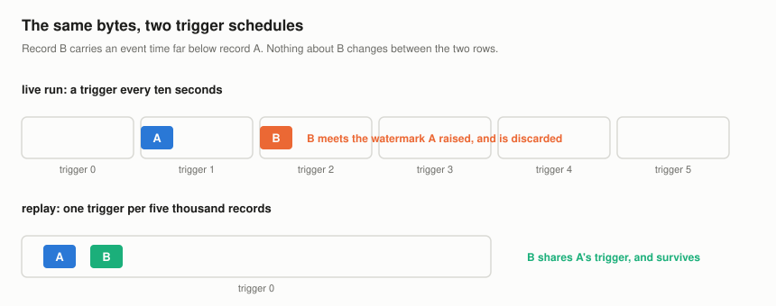
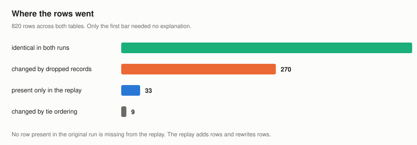
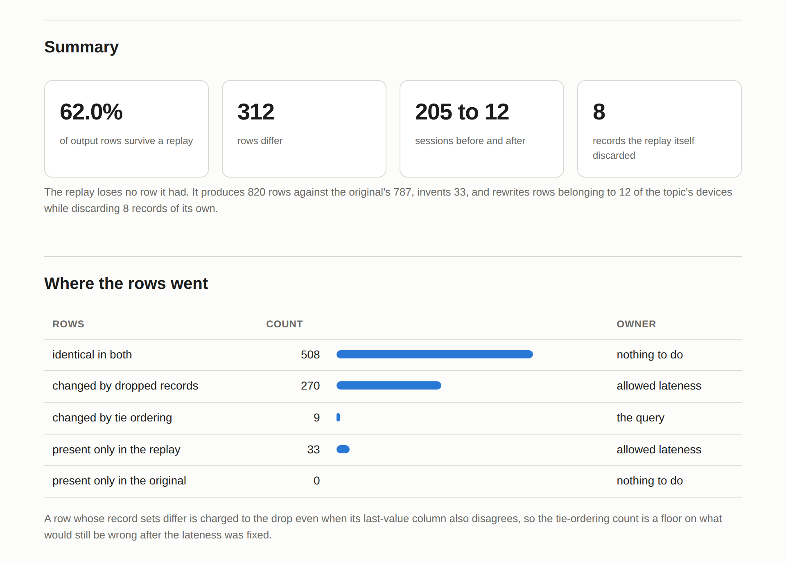

# stream-replay-divergence

A commit log records what arrived. It structurally cannot record what the job
decided to forget, because that decision belongs to the consumer and is made
from state the producer never sees. So replaying the log does not reproduce a
stateful job's output. It re-derives it, from a position that is strictly more
forgiving, and the two answers differ.

This repository measures by how much, on a log it ships, with a job it ships,
and it proves the one thing that can be proved and then shows that the proof is
about the wrong pair of runs.

The shipped log holds 30,000 records across four partitions and six hours of
event time, delivered out of order by a network that stalls one partition
partway through. The headline, from `docs/experiments/exp01.json`:

> The original run's table holds 787 rows. Reprocessing the same topic produces
> 820 rows, and 508 of them are identical to the original. 62.0% of the rows
> survive. Reprocessing loses 0 rows and invents 33 rows. That is a harder
> failure to notice than losing them would be, and it rewrites rows belonging to
> all 12 devices in the topic while it discards 8 records of its own.

And the part that is not probabilistic at all:

> The original run emitted 205 sessions. Those become 12 sessions on a replay,
> which is 94.1% of the session table gone, and no replay setting recovers it.

## The impossibility

A watermark is a promise: no record below this event time will arrive from here
on. The engine acts on it by closing windows and discarding whatever contradicts
it. The promise is made from one observation, the highest event time seen so far,
and it is evaluated once per micro-batch and applied to the next one.

So a record survives if it shares a batch with the record that would have
condemned it, and dies if it falls into the following batch. Nothing about the
record changed. The trigger did.

A live job triggers on wall clock. A replay cannot: every record it reads back
is already sitting in the log, and the arrival times that drove the original
triggers were never written anywhere. The two runs therefore batch differently,
by two orders of magnitude, and they make different decisions about the same
bytes.

There is no configuration that fixes this, and the tool will not pretend
otherwise. Asking it to replay with a live batching is refused rather than
answered:

```
$ srd run --batching live
a live batching cannot be rebuilt from the log: every record in it carries the
same arrival time, so the result would be one batch wearing a live run's name
```



## What can be proved, and what it is about

Fix a log and an allowed lateness. Every batching a consumer can produce
respects offset order, so the watermark a record faces comes from some prefix of
the records ahead of it, and that prefix is bounded at both ends. Put the record
in the first batch and the watermark is the starting sentinel, below everything.
Put every record in its own batch and the watermark is the highest earlier stamp
minus the slack.

Each record therefore lands in one of two classes and there is no third:

- **stable-keep**, whose stamp clears even the highest possible line, so no
  batching can discard it;
- **contingent**, kept under some batchings and dropped under others.

The class that does not exist is the point. No record is dropped under every
batching, so a replay that reads the whole topic in one batch keeps everything
the original threw away. This is not a tuning problem; allowed lateness only
moves the line, and the single-batch line starts below all of them.

`src/srd/bounds.py` computes the classification in one pass over the log, and
`exhaustive_fates` recomputes it by enumerating all two-to-the-n-minus-one
batchings so a property test can pin the argument against brute force on every
small log it can generate.

On the shipped log, 2,633 records are contingent, which is 8.8% of the log, and
73 rows can differ because of them, 9.3% of the table, spanning 365 minutes
of event time.

**And that bound is about the wrong pair of runs.**

Every replay reads the log in offset order, so the bound holds exactly between
replays. Across 10 pairs of replays at batch sizes from `250` to 30,000 records,
0 rows fall outside it. But the original run processed in *arrival* order, which
is a different permutation of the same records, and the permutation is not in
the log. Against the original, 239 of the rows that differ lie outside the
window, and the bound understates it by 4.3 times. It names 1 device. Twelve
devices actually moved.

An operator can compute, before touching anything, how far one reprocessing
lands from another. They cannot compute how far either lands from the run that
produced the table they already have.

## Where the rows went

Every differing row is charged to exactly one mechanism, and each has a
different owner.



<!-- table:arms generated by tools/render_tables.py from exp01.json -->
| rows | count | owner |
| --- | --- | --- |
| identical in both | 508 | nothing to do |
| changed by dropped records | 270 | allowed lateness |
| changed by tie ordering | 9 | the query's last-value column |
| present only in the replay | 33 | allowed lateness |
| present only in the original | 0 | nothing to do |
<!-- /table:arms -->

312 rows differ, 270 of them because the two runs disagree about which records
existed, and 9 differ only in a last-value column while agreeing on every count
and sum. That second number is the floor: it is what would still be wrong the
day after the allowed lateness was fixed, because a last-value column over a
one-second timestamp has no defined answer and the engine is not at fault for
picking one.

## What widening the allowed lateness buys

<!-- table:lateness generated by tools/render_tables.py from exp03.json -->
| allowed lateness | records the original dropped | replay-stable rows | rows still differing | of those, tie ordering |
| --- | --- | --- | --- | --- |
| 5 s | 48.7% | 0.1% | 819 | 0 |
| 15 s | 26.3% | 5.7% | 773 | 1 |
| 30 s | 8.1% | 85.1% | 122 | 8 |
| 60 s | 1.6% | 90.9% | 75 | 8 |
| 120 s | 0.0% | 98.7% | 11 | 8 |
| 300 s | 0.0% | 99.0% | 8 | 8 |
<!-- /table:lateness -->

At five seconds the replay-stable share falls to 0.1%. At five minutes it
reaches 99.0% and stops, against a floor of 8 rows that no watermark setting
touches, because those rows differ for a reason the watermark has nothing to do
with.

## Where this result stops being robust

The shipped fixture sits on the shoulder of a cliff, and a repository that
quoted the headline without saying so would be quoting a number that looks
sturdier than it is. The cliff is where the spread of delivery delays passes the
allowed lateness: below it a few records are late, above it a late record raises
the watermark past the records behind it and the drops compound.

<!-- table:jitter generated by tools/render_tables.py from exp03.json -->
| delivery spread | records the original dropped | replay-stable rows |
| --- | --- | --- |
| up to 5 s | 8.2% | 89.5% |
| up to 20 s | 7.9% | 89.4% |
| up to 30 s | 7.9% | 89.6% |
| up to 38 s | 8.1% | 85.1% |
| up to 45 s | 11.4% | 49.6% |
| up to 60 s | 25.6% | 5.4% |
<!-- /table:jitter -->

The collapse arrives at 45 seconds of spread, against an allowed lateness of 30
seconds. The shipped fixture is at 38 seconds, which is deliberately just below
it: far enough in that the effect is real, close enough to the edge that the
sensitivity has to be disclosed rather than buried.

## Why the sessions are worse

The aggregate's divergence is a function of which records got dropped, so it
responds to configuration. The session table's divergence is a function of wall
clock, and a replay's wall clock is not the original's: six hours of traffic
arrive inside a few milliseconds, no gap ever elapses, and every key produces
one session.

Every replay setting there is, batch size against time per batch:

<!-- table:sessions generated by tools/render_tables.py from exp05.json -->
| records per batch | 1 ms per batch | 10 ms per batch | 100 ms per batch | 1000 ms per batch | 10000 ms per batch |
| --- | --- | --- | --- | --- | --- |
| 100 | 12 | 12 | 12 | 12 | 21 |
| 500 | 12 | 12 | 12 | 12 | 12 |
| 2,000 | 12 | 12 | 12 | 12 | 12 |
| 5,000 | 12 | 12 | 12 | 12 | 12 |
| 15,000 | 12 | 12 | 12 | 12 | 12 |
| 30,000 | 12 | 12 | 12 | 12 | 12 |
<!-- /table:sessions -->

30 combinations, none of which reproduces the table. The best of them recovers
21 of the original's sessions, and to match the original's wall-clock span it
would have to run a further 7.2 times slower, which is another way of saying
that reprocessing six hours of traffic faithfully takes six hours.

Meanwhile the counter every team already has, records dropped, read 8 out of
thirty thousand at the shipped replay setting. Nothing would have alerted.

## The metric that would have caught it

`srd_records_dropped_total` is true and insufficient. `srd_watermark_lag_ms` was
tried and removed: lag defined as the highest stamp minus the watermark equals
the allowed lateness whenever the line has caught up, so the dashboard is a flat
line by construction.

What is exposed instead is the deficit between the partition driving the global
watermark and the slowest partition's own newest record. It is zero when
partitions keep pace and it crosses the allowed lateness exactly when a
partition's fresh records begin arriving already condemned. On the shipped log
the slowest partition runs 44 seconds behind, against an allowed lateness of 30
seconds, which is the whole story in one gauge.

Switching to a per-partition watermark is one boolean. It costs 501 records of
the original run's drops and lifts the replay-stable share to 79.6% and no
further, so it is worth doing and it is not a fix.

## Running it

Everything is offline and deterministic. No API keys, no cloud credentials, no
network at runtime.

```bash
python3 -m venv .venv && . .venv/bin/activate
pip install -e ".[dev]"
make verify
```

`make verify` runs the suite with branch coverage, regenerates every experiment,
rewrites the generated tables, and fails if any document quotes a figure the
code no longer produces.

```bash
srd generate                 # write the log and the original run's table
srd bounds                   # classify every record from the log alone
srd replay                   # rebuild the table and diff it
srd witness 15179            # explain one record's fate
srd metrics                  # the scrape body the job would expose
```

Exit codes are four, and two of them are not failures:

| code | meaning |
| --- | --- |
| 0 | the replay agreed, or the question had a clean answer |
| 2 | the tool was handed something it cannot work with |
| 3 | a divergence was found |
| 4 | the question cannot be answered from what was supplied |

Three is a finding and four is a refusal. A pipeline that treats every non-zero
code as a failure pages somebody for both, which is backwards.

## Bugs the measurement found

Five, each committed as its own fix with the story attached.

**The partitioner moved every published figure between runs.** Records were
placed in partitions with Python's built-in `hash`, which is randomised per
process. Every run produced a different topic and every number moved with it.
Caught by a sweep reporting `0.9915` on one run and `0.9927` on the next with no
code changed in between. The tests had not caught it because every one of them
asserted a property rather than a value, which is usually the right instinct and
is exactly why this survived.

**The rewrite window claimed a scope it does not have.** Its docstring said it
bounded what a replay can change relative to the original. Writing the
cross-check put 239 rows outside a window that was supposed to contain them. The
theorem is correct; it quantifies over batchings of a fixed processing order, and
the original's processing order is a different permutation that the log does not
record. This is now the repository's main result rather than a footnote.

**A watermark-lag gauge that was constant by construction.** It printed exactly
the configured allowed lateness on every run, which is what a metric does when it
has been defined as a quantity the policy fixes. Replaced with the partition
deficit.

**The partition deficit then had a bug of its own.** It compared the global
maximum only against the partition the current record belonged to, so a
partition that had gone silent was never measured, and going silent is the
condition the gauge exists to catch. It reported `900` milliseconds on a log whose
real deficit was `8,900`.

**The CLI let a replay ask for a live batching.** Every record read back from a
log carries the same arrival time, so a wall-clock batcher produced one enormous
batch and labelled it a live run. It printed one batch for a six-hour topic,
which looked like a bug in the batcher rather than the category error it was.
Now refused, with the reason.

## How the numbers stay true

Every figure in this document is produced by code that ran. `tools/collect_metrics.py`
re-measures all of them into `docs/metrics.json`, and `tools/check_numbers.py`
fails the build when a document quotes one the code no longer produces. It runs
three passes: every metric must appear somewhere with its current value, every
document is searched separately for stale wording, and every number in this
README must correspond to a metric so that a figure nothing re-measures cannot
quietly appear.

The tables above are generated between committed marker comments and CI fails if
regenerating them changes the file.

393 tests, 100.0% line and 100.0% branch coverage, and the suite runs offline
from a fresh clone.

## The report

`make report` builds `docs/report.html`, a single offline page with the
verdict at the top, and screenshots it with Chromium. The screenshot tool reads
back the computed style of the verdict badge and fails when it is illegible,
because a screenshot tool is the only thing in the pipeline that can see pixels.



## Reading order

1. `src/srd/events.py` for why the log and the observation are two types
2. `src/srd/bounds.py` for the proof and for what it is not about
3. `docs/adr/` for the five decisions and their costs
4. `docs/runbook.md` for what to do when somebody says "just reprocess from Kafka"
